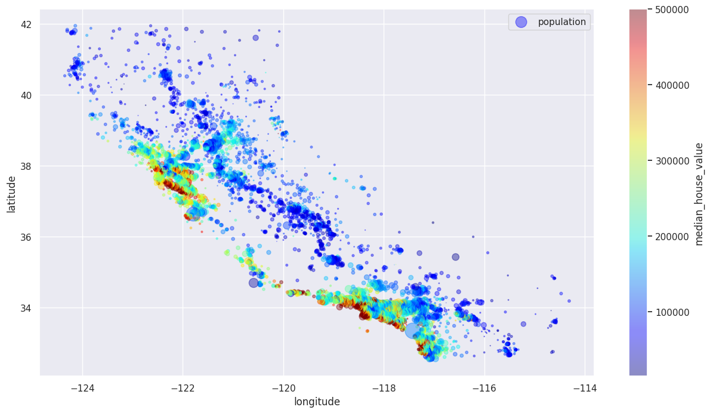
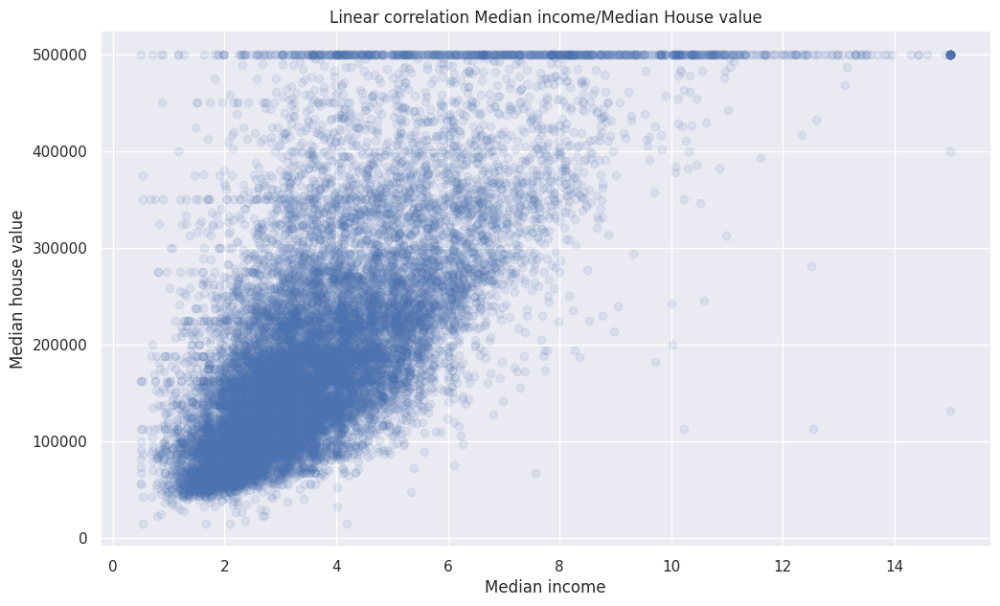

# California Housing Dataset Analysis

**Notebook:** [view with all outputs (nbviewer)](https://nbviewer.org/github/NusratBegum/California-Housing-Dataset-Analysis/blob/main/Nusrat_Project.ipynb) · [open in Colab](https://colab.research.google.com/github/NusratBegum/California-Housing-Dataset-Analysis/blob/main/Nusrat_Project.ipynb)





## 📊 Project Overview

This project performs comprehensive data analysis and visualization on the California Housing Dataset. The analysis explores housing prices across California, examining relationships between various features such as location, median income, housing age, and population density.

## 🎯 Objectives

- Explore and understand the California Housing Dataset
- Perform data cleaning and preprocessing
- Visualize geographical distribution of housing data
- Analyze correlations between different housing features
- Create insightful visualizations to understand housing price patterns
- Apply data normalization techniques for better distribution analysis

## 📁 Dataset Information

The California Housing Dataset contains information about housing blocks in California from the 1990 census.

**Data Sources:**
- [Kaggle - California Housing Prices](https://www.kaggle.com/datasets/camnugent/california-housing-prices)
- [Google ML Crash Course - California Housing Data Description](https://developers.google.com/machine-learning/crash-course/california-housing-data-description)

**Features:**
- `longitude`: Longitude coordinate of the housing block
- `latitude`: Latitude coordinate of the housing block
- `housing_median_age`: Median age of houses within a block (lower number = newer building)
- `total_rooms`: Total number of rooms within a block
- `total_bedrooms`: Total number of bedrooms within a block
- `population`: Total number of people residing within a block
- `households`: Total number of households (group of people in a home unit) for a block
- `median_income`: Median income for households within a block (in tens of thousands of US Dollars)
- `median_house_value`: Median house value for households within a block (in US Dollars)

## 🚀 Getting Started

### Prerequisites

Make sure you have Python installed along with the following libraries:

```bash
pip install numpy pandas matplotlib seaborn jupyter
```

### Installation

1. Clone this repository:
```bash
git clone https://github.com/NusratBegum/California-Housing-Dataset-Analysis.git
cd California-Housing-Dataset-Analysis
```

2. Launch Jupyter Notebook:
```bash
jupyter notebook Nusrat_Project.ipynb
```

Alternatively, you can open the notebook directly in [Google Colab](https://colab.research.google.com/github/NusratBegum/California_Housing_Dataset_Analysis/blob/main/Nusrat_Project.ipynb).

## 📈 Analysis Workflow

The project follows a structured data analysis approach:

1. **Data Import**: Load the California Housing dataset
2. **Data Exploration**: 
   - View dataset structure and basic statistics
   - Check for missing values and data types
3. **Data Cleaning**: 
   - Handle missing/null values using dropna()
4. **Exploratory Data Analysis**:
   - Generate histograms for all features
   - Analyze distribution of individual features (rooms, bedrooms, population, income, house values)
5. **Correlation Analysis**:
   - Create correlation matrix
   - Visualize correlations using heatmaps
6. **Geographical Visualization**:
   - Plot housing locations using latitude/longitude
   - Visualize population density and house values on California map
7. **Distribution Analysis**:
   - Create KDE (Kernel Density Estimation) plots for feature distributions
   - Apply log normalization to skewed features
   - Analyze normalized distributions

## 🔍 Key Insights

The analysis reveals:
- Strong linear correlation between median income and median house value
- Geographical clustering of housing prices along coastal regions
- Distribution patterns of housing features across California
- Impact of population density on housing characteristics
- Age distribution of housing blocks

## 🛠️ Technologies Used

- **Python 3.x**: Programming language
- **NumPy**: Numerical computations
- **Pandas**: Data manipulation and analysis
- **Matplotlib**: Data visualization and plotting
- **Seaborn**: Statistical data visualization
- **Jupyter Notebook**: Interactive development environment

## 📊 Visualizations

The project includes various visualizations:
- Histograms of all features
- Correlation heatmaps
- Geographical scatter plots
- Population density maps
- KDE distribution plots
- Normalized distribution plots

## 📝 Project Structure

```
California-Housing-Dataset-Analysis/
│
├── Nusrat_Project.ipynb    # Main Jupyter notebook with complete analysis
└── README.md               # Project documentation
```

## 🤝 Contributing

Contributions are welcome! Feel free to open issues or submit pull requests.

## 📄 License

This project is open source and available for educational purposes.

## 👤 Author

**Nusrat Begum**

## 🙏 Acknowledgments

- Dataset provided by Kaggle and Google ML Crash Course
- California Housing Prices dataset from the 1990 U.S. Census